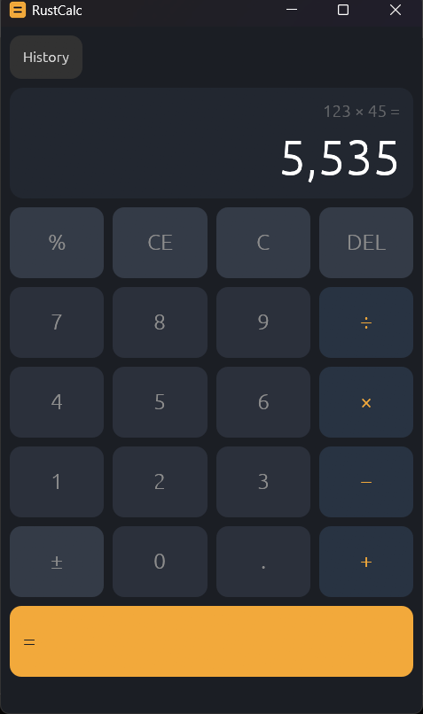

# RustCalc

A fast, portable calculator for Windows, macOS and Linux, built in Rust with
[egui](https://github.com/emilk/egui).



## Features

- Arithmetic with decimals and sign toggle
- Windows-style percent: `50 + 10 %` `=` gives `55`
- Calculation history: click an entry to recall its result; saved across restarts
- Full keyboard support (see below)
- Native binaries for Windows, macOS (Apple silicon and Intel) and Linux
- No runtime dependencies — unpack and run

## Download

Grab the latest build for your platform from
[Releases](https://github.com/siddharthsg2/RustCalc/releases/latest):

| Platform             | Archive                                         |
| -------------------- | ----------------------------------------------- |
| Windows (x64)        | `rustcalc-vX.Y.Z-x86_64-pc-windows-msvc.zip`    |
| macOS (Apple silicon)| `rustcalc-vX.Y.Z-aarch64-apple-darwin.tar.gz`   |
| macOS (Intel)        | `rustcalc-vX.Y.Z-x86_64-apple-darwin.tar.gz`    |
| Linux (x64)          | `rustcalc-vX.Y.Z-x86_64-unknown-linux-gnu.tar.gz` |

Unpack the archive and run `rustcalc` (`rustcalc.exe` on Windows).

## Keyboard

| Key                 | Action                    |
| ------------------- | ------------------------- |
| `0`–`9`, `.` or `,` | Digits and decimal point  |
| `+`, `-`, `*`, `/`  | Operators                 |
| `%`                 | Percent (Windows semantics) |
| `Enter` or `=`      | Evaluate                  |
| `Backspace`         | Delete last digit         |
| `Delete`            | Clear entry (CE)          |
| `Esc`               | Clear all (C)             |

## Building from source

Requires Rust 1.95 or newer.

```sh
cargo run -p rustcalc-app
```

## Project layout

- `crates/rustcalc-core` — pure calculator logic with no GUI dependencies,
  verified with unit tests, property tests and
  [`cargo-mutants`](https://github.com/sourcefrog/cargo-mutants)
- `crates/rustcalc-app` — thin [eframe](https://github.com/emilk/eframe) shell
  with headless UI tests via
  [`egui_kittest`](https://github.com/emilk/egui/tree/main/crates/egui_kittest)

CI runs formatting, Clippy (`-D warnings`) and the full test suite on Windows,
macOS and Linux. Pushing a `v*` tag builds and publishes release binaries.

## License

[MIT](LICENSE)
